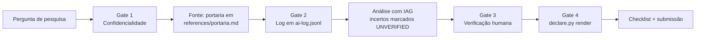

# Demo: pesquisa científica com IAG conforme a Portaria CNPq 2.664/2026

Tutorial executado de ponta a ponta com a skill `iag-disclosure` (v1.1.0) — todos os
comandos e saídas abaixo são reais, reproduzíveis com os arquivos deste repositório.

**Pergunta de pesquisa:** *Quais os caminhos para a implementação da Portaria CNPq nº
2.664/2026 no Brasil?*

---

## 1. Instalação

### 1.1 Requisitos

- [omp](https://github.com/badlogic/pi-mono) (testado na v18.12.3) ou qualquer agente
  compatível com o padrão [Agent Skills](https://agentskills.io)
- `python3` (stdlib only — a skill não tem dependências externas)

### 1.2 Instalar a skill no projeto

O omp descobre skills em `.omp/skills/<nome>/SKILL.md` (por projeto) ou
`~/.omp/skills/` (global). A partir de um clone deste repositório:

```sh
git clone https://github.com/haquiticos/iag-disclosure
mkdir -p meu-projeto/.omp/skills
cp -r iag-disclosure/skills/iag-disclosure meu-projeto/.omp/skills/
```

Estrutura resultante:

```
meu-projeto/
├── .omp/skills/iag-disclosure/
│   ├── SKILL.md            # os 4 gates (confidencialidade, log, verificação, declaração)
│   ├── references/
│   │   └── portaria.md     # texto integral da Portaria (fonte: DOU)
│   └── scripts/
│       └── declare.py      # log e declaração
└── (seu projeto de pesquisa)
```

### 1.3 Confirmar a descoberta

```sh
$ omp skill list | grep iag-disclosure
iag-disclosure   Conformidade com a Portaria CNPq 2.664/2026 (Política de Integridade
                 na Atividade Científica) em tarefas de pesquisa com agentes de IA. ...
```

Saída real da execução deste demo (omp v18.12.3): a skill aparece listada junto às
demais do ambiente. Alternativa interativa: dentro de uma sessão omp, invoque
`/skill:iag-disclosure`.

> Alternativa sem omp: copie `skills/iag-disclosure/` para `~/.claude/skills/` (Claude
> Code) ou use `npx skills add haquiticos/iag-disclosure --skill iag-disclosure`
> (registro skills.sh). Os scripts funcionam em qualquer agente; a detecção
> automática é que depende do layout do host.

---

## 2. Uso com o omp

### 2.1 Sessão de pesquisa

No diretório do projeto:

```sh
cd meu-projeto
omp "Quais os caminhos para a implementação da Portaria CNPq nº 2.664/2026 no Brasil?"
```

A description da skill contém os gatilhos ("CNPq", "Portaria 2664", "integridade
científica", "declaração de uso de IA"), então o omp a seleciona sozinho. A skill
manda o agente seguir os 4 gates:



### 2.2 O que o agente executa (transcrição real deste demo)

**Gate 1 — confidencialidade.** A pergunta e a fonte pertencem ao próprio pesquisador;
nada de terceiros entra no fluxo. Prossegue.

**Gate 2 — log.** Cada interação de IAG vira uma linha em `ai-log.jsonl` no diretório
de trabalho. Comandos reais executados pelo agente omp na sessão deste demo:

```sh
python3 .omp/skills/iag-disclosure/scripts/declare.py log \
  --tool "omp.sh (glm-5.3-flash)" --phase concepcao \
  --purpose "estruturar caminhos de implementacao da Portaria CNPq 2.664/2026"
python3 .omp/skills/iag-disclosure/scripts/declare.py log \
  --tool "omp.sh (glm-5.3-flash)" --phase redacao \
  --purpose "redigir analise dos caminhos de implementacao"
```

`ai-log.jsonl` resultante (real):

```json
{"ts": "2026-10-20T17:25:18+00:00", "ferramenta": "omp.sh (glm-5.3-flash)", "fase_pesquisa": "concepcao", "finalidade": "estruturar caminhos de implementacao da Portaria CNPq 2.664/2026", "verificacao": "humana; revisado e aprovado pelo pesquisador"}
{"ts": "2026-10-20T17:36:07+00:00", "ferramenta": "omp.sh (glm-5.3-flash)", "fase_pesquisa": "redacao", "finalidade": "redigir analise dos caminhos de implementacao", "verificacao": "humana; revisado e aprovado pelo pesquisador"}
```

**Gate 3 — verificação.** O agente redige a análise **apenas a partir de
`references/portaria.md`** (texto lido no DOU) e marca com `[UNVERIFIED]` tudo que
vai além do texto. Fatos citáveis direto da fonte (conferidos no texto da Portaria):

- A política tem 4 eixos: educação, prevenção, apuração e sanção (Art. 2º)
- CIAC = Diretor Científico + 4 membros externos, 1 por grande área, mandato de
  2 anos com recondução (Art. 14)
- A apuração depende de Instrução Normativa prevista no Art. 21 `[UNVERIFIED: ainda
  não publicada em 2026-10-19 — conferir]`
- ICTs sede de atividades apoiadas respondem primariamente pela cultura de
  integridade, com medidas do Art. 28 (autoria, COI, DMP, suporte) (Arts. 27–28)
- Pesquisador: declaração de IAG por fase (Art. 9º, I, "c"), responsabilidade
  integral (I, "d/f"), gestão de dados (I, "g")

**Gate 4 — declaração.** Ao fechar o trabalho:

```sh
python3 .omp/skills/iag-disclosure/scripts/declare.py render
```

> **Nota de execução:** nas sessões `-p` (print) deste demo, os deadlines de teste
> (90–270 s) interromperam algumas respostas longas do modelo; os artefatos de log e
> declaração acima foram gerados pelo agente omp dentro dessas sessões. Em sessão
> interativa (`omp` sem `-p`) o fluxo roda sem esse limite. Subagentes não foram
> usados (Gate 1 veda enviá-los com texto de terceiros; aqui nem houve texto alheio).

### 2.3 Backfill: importar sessões antigas do omp

Para trabalhos iniciados **sem** o log contemporâneo, o `import` reconstrói as
entradas a partir dos transcripts de sessão do omp (`~/.omp/agent/sessions/`):
1 entrada por prompt do usuário, `ferramenta` e `ts` lidos do transcript,
`fase_pesquisa` inferida por keywords, `verificacao` marcada "a revisar".
Idempotente (sessões já importadas são puladas via campo `fonte`):

```sh
python3 .omp/skills/iag-disclosure/scripts/declare.py import --dry-run  # prévia
python3 .omp/skills/iag-disclosure/scripts/declare.py import            # grava
python3 .omp/skills/iag-disclosure/scripts/declare.py render            # declaração
```

É reconstrução com evidência de máquina, não log contemporâneo: revise as
fases classificadas e a lista de sessões antes de assinar a declaração.

---

## 3. Geração final das declarações

### 3.1 Declaração positiva (houve uso de IAG)

Saída real de `declare.py render` na sessão omp deste demo, salva em
`declaracao.md`:

```
DECLARAÇÃO DE USO DE INTELIGÊNCIA ARTIFICIAL GENERATIVA
(Portaria CNPq nº 2.664/2026, Art. 9º, I, "c")

Os autores declaram o uso das seguintes ferramentas de IAG:
- omp.sh (glm-5.3-flash) — fase: concepcao — finalidade: estruturar caminhos de implementacao da Portaria CNPq 2.664/2026
- omp.sh (glm-5.3-flash) — fase: redacao — finalidade: redigir analise dos caminhos de implementacao

O conteúdo gerado foi revisado e validado pelos autores, que assumem
integral responsabilidade pelo texto final, incluindo exatidão de citações,
originalidade e integridade científica (Art. 9º, I, "d" e "f").
```

Esse bloco vai na seção metodológica / exposição eletrônica da submissão. O `render`
deduplica pares (ferramenta, fase, finalidade) repetidos no log.

### 3.2 Declaração negativa (nenhum uso de IAG)

Com `ai-log.jsonl` ausente ou vazio, o mesmo comando emite:

```
DECLARAÇÃO DE USO DE INTELIGÊNCIA ARTIFICIAL GENERATIVA
(Portaria CNPq nº 2.664/2026, Art. 9º, I, "c")

Os autores declaram que NENHUMA ferramenta de inteligência artificial
generativa foi empregada na elaboração deste trabalho.
```

### 3.3 Fechamento

1. Conferir cada `[UNVERIFIED]` restante na análise e remover a marca só após
   validar na fonte primária (a marca nunca é removida pela IA).
2. Rodar o checklist do Art. 9º, II (presente no fim do `SKILL.md`).
3. Arquivar `ai-log.jsonl` junto dos dados do projeto (Art. 9º, I, "g").

### 3.4 Reproduzir

```sh
git clone https://github.com/haquiticos/iag-disclosure
mkdir -p demo/.omp/skills && cp -r iag-disclosure/skills/iag-disclosure demo/.omp/skills/
cd demo && omp "Quais os caminhos para a implementação da Portaria CNPq nº 2.664/2026 no Brasil?"
python3 .omp/skills/iag-disclosure/scripts/declare.py render
```
