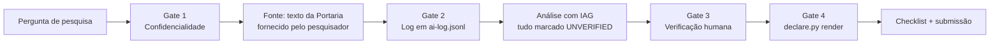

# Demo: pesquisa científica com IAG conforme a Portaria CNPq 2.664/2026

Tutorial executado de ponta a ponta com a skill `iag-disclosure` (v1.1.0) — todos os
comandos e saídas abaixo são reais, reproduzíveis com os arquivos deste repositório.

**Pergunta de pesquisa:** *Quais os caminhos para a implementação da Portaria CNPq nº
2.664/2026 no Brasil?*

A seguir: (1) o passo a passo do fluxo da skill, (2) o resultado analítico produzido
com a IA, (3) a declaração exigida pelo Art. 9º, I, "c", (4) o checklist de submissão.

---

## 1. O fluxo executado



### Passo 0 — Gate 1 (confidencialidade)

A pergunta e a fonte (texto integral da Portaria, em
`skills/iag-disclosure/references/portaria.md`, lido no DOU) pertencem ao próprio
pesquisador; nada de terceiros entra no fluxo. Nenhum dado sensível de participantes
ou de proposta alheia é usado. Sem impedimentos — prossegue.

### Passo 1 — Gate 2 (log): registrar cada interação de IAG

Criar o diretório do projeto e registrar as interações conforme acontecem
(append-only — erro novo = linha nova):

```sh
mkdir -p projeto-portaria2664 && cd projeto-portaria2664
python3 <caminho-da-skill>/scripts/declare.py log \
  --tool "omp.sh (glm-5.3-flash)" --phase concepcao \
  --purpose "estruturar caminhos de implementacao da Portaria CNPq 2.664/2026 a partir do texto normativo (Art. 2-4, 9-16, 17-25, 26-29, 30-37)"
python3 <caminho-da-skill>/scripts/declare.py log \
  --tool "omp.sh (glm-5.3-flash)" --phase redacao \
  --purpose "redigir quadro de caminhos de implementacao e tutorial docs/demo.md"
python3 <caminho-da-skill>/scripts/declare.py log \
  --tool "omp.sh (glm-5.3-flash)" --phase submissao \
  --purpose "gerar declaracao final de uso de IAG e checklist de submissao"
```

Saída real (`ai-log.jsonl`, truncada):

```json
{"ts": "2026-10-20T14:45:53+00:00", "ferramenta": "omp.sh (glm-5.3-flash)", "fase_pesquisa": "concepcao", "finalidade": "estruturar caminhos de implementacao da Portaria CNPq 2.664/2026 a partir do texto normativo (Art. 2-4, 9-16, 17-25, 26-29, 30-37)", "verificacao": "humana; revisado e aprovado pelo pesquisador"}
```

Três fases da pesquisa ficam registradas: `concepcao`, `redacao`, `submissao` —
exatamente o vocabulário do Art. 9º, I, "c".

### Passo 2 — Análise com a fonte fornecida pelo pesquisador

A IA trabalhou **apenas sobre o texto normativo fornecido** (Gate 3: todo fato
não conferido em fonte primária nasce `[UNVERIFIED]`). O resultado está na seção 2.

### Passo 3 — Gate 4 (declaração): gerar a declaração do Art. 9º, I, "c"

```sh
python3 <caminho-da-skill>/scripts/declare.py render
```

Saída real:

```
DECLARAÇÃO DE USO DE INTELIGÊNCIA ARTIFICIAL GENERATIVA
(Portaria CNPq nº 2.664/2026, Art. 9º, I, "c")

Os autores declaram o uso das seguintes ferramentas de IAG:
- omp.sh (glm-5.3-flash) — fase: concepcao — finalidade: estruturar caminhos de implementacao da Portaria CNPq 2.664/2026 a partir do texto normativo (Art. 2-4, 9-16, 17-25, 26-29, 30-37)
- omp.sh (glm-5.3-flash) — fase: redacao — finalidade: redigir quadro de caminhos de implementacao e tutorial docs/demo.md
- omp.sh (glm-5.3-flash) — fase: submissao — finalidade: gerar declaracao final de uso de IAG e checklist de submissao

O conteúdo gerado foi revisado e validado pelos autores, que assumem
integral responsabilidade pelo texto final, incluindo exatidão de citações,
originalidade e integridade científica (Art. 9º, I, "d" e "f").
```

Este bloco é o que vai na seção metodológica / exposição eletrônica da submissão.

---

## 2. Resultado analítico: caminhos de implementação

> **Status de verificação:** citações dos Arts. citados foram conferidas no texto da
> Portaria (fonte primária, DOU 11/03/2026 — cópia em
> `skills/iag-disclosure/references/portaria.md`). Itens marcados `[UNVERIFIED]`
> dependem de conferência do pesquisador em fonte primária antes de qualquer
> publicação (Gate 3).

### 2.1 Panorama normativo

A Portaria institui a Política de Integridade na Atividade Científica com quatro
eixos — **educação, prevenção, apuração e sanção** (Art. 2º) — e aplica-se a cinco
públicos (Art. 4º): proponentes/beneficiários, usuários das plataformas digitais
(Lattes, Carlos Chagas), pesquisadores com acesso a dados do CNPq, servidores e
**membros de Comitês e consultores ad hoc**. Revoga a Portaria 1.735/2024 e a RN
006/2012 (Art. 39). Vigência: 7 dias úteis após a publicação (Art. 40) — ou seja,
em plena produção de efeitos desde março de 2026.

### 2.2 Os cinco caminhos de implementação

| # | Caminho | Base normativa | Agentes responsáveis | Marco de êxito |
|---|---|---|---|---|
| 1 | **Estruturação da governança** — instalar CIAC (Diretor Científico + 4 membros externos, 1 por grande área, mandato 2 anos) e Secretaria Técnica | Arts. 10–16 | CNPq | CIAC instalada e reunindo ordinariamente a cada 3 meses (Art. 15) |
| 2 | **Regulação operacional da apuração** — editar a Instrução Normativa do Art. 21 (documentação, análise preliminar, admissibilidade, apuração) e integrar Ouvidoria/Fala.BR (Arts. 17–25) | Arts. 17–25 | CNPq/Ouvidoria/CIAC | IN publicada; fluxo Fala.BR → admissibilidade → apuração sob sigilo funcionando |
| 3 | **Aderência das ICTs** — orientar pesquisadores, cultura institucional, critérios de autoria, regras de conflito de interesses, plano de gestão de dados, canal de suporte | Arts. 26–29 | ICTs sede de atividades apoiadas | Medidas do Art. 28 (I–IV) incorporadas ao regulamento interno das ICTs |
| 4 | **Aderência do pesquisador** — declaração de uso de IAG por fase (concepção, redação, análise de dados, submissão), responsabilidade integral pelo conteúdo final, gestão conservação de dados/código, critérios de autoria ICMJE | Art. 9º, I, "c"–"g" e II | Pesquisadores/bolsistas | Declarações presentes nas submissões; logs de uso de IAG auditáveis; dados depositados em repositórios confiáveis |
| 5 | **Educação, prevenção e enforcement** — disseminar o Código de Boas Práticas (Art. 6º), deveres de avaliadores (Art. 7º), tipificação de infrações (Arts. 30–33) e sanções (Arts. 34–37) | Arts. 3º, 6º, 7º, 30–37 | CNPq + ICTs | Capacitações realizadas; apurações instruídas; dosimetria aplicada com ampla defesa (Art. 22) |

### 2.3 Sequência de implementação (leitura do texto)

1. **Curto prazo** (governança): a CIAC depende de indicação pelo Conselho
   Deliberativo a partir de lista tríplice da DEX (Art. 14, §2º) — sem ela, não há
   juízo de admissibilidade das denúncias (Art. 18).
2. **Curto prazo** (regulação): a IN do Art. 21 é pré-requisito para que a apuração
   tenha procedimento vinculante. Situação em 2026-10-19: **ainda não localizada
   publicamente** `[UNVERIFIED]` (fonte secundária: nota de pesquisa em
   `docs/pesquisa-skills-portaria.md`).
3. **Médio prazo** (ICTs): os deveres do Art. 27 são primários da instituição —
   a implementação prática se dá por regulamentos internos que detalhem o Art. 28.
4. **Contínuo** (pesquisador): o Art. 9º, I, "c" produz efeito imediato — toda
   submissão a editais/periódicos com fomento CNPq passa a exigir a declaração
   de IAG desde a vigência (março/2026).
5. **Contínuo** (educação/sanção): os eixos educação (Art. 3º) e sanção
   (Arts. 34–37) operam em paralelo; a dosimetria considera gravidade, dolo,
   reincidência em 5 anos (Art. 36).

### 2.4 Pontos de atenção levantados pela IA (todos `[UNVERIFIED]`)

- **Capacidade apuratória:** 5 membros na CIAC + reuniões trimestrais (Art. 15)
  pode ser gargalo para o volume de denúncias via Fala.BR. Conferir se a IN prevê
  delegação às unidades ou às ICTs.
- **Composição da CIAC:** mandato de 2 anos com recondução (Art. 14, §3º) —
  acompanhar a primeira designação para avaliar independência dos membros externos.
- **Art. 19:** a competência do CNPq restringe-se a sistemas próprios e fomento,
  "sem prejuízo da apuração primária pelas instituições" — a efetividade depende
  de as ICTs terem comitês de integridade próprios instalados. Não há prazo
  explícito na Portaria para isso `[UNVERIFIED]`.
- **Erros de OCR na fonte** (ex.: "¿" no lugar de espaços, Art. 16, 19, 27):
  conferir sempre o DOU antes de citar literalmente.

**Riscos do uso de IAG nesta pesquisa (transparência, Art. 9º, I, "d/f"):** a
análise acima foi gerada por IA a partir do texto normativo; interpretações
jurídicas (ex.: leitura de "caminho" e sequenciamento) são proposição da IA e
precisam de validação pelo pesquisador antes de publicação. Nenhuma referência
externa foi inserida pela IA sem marca `[UNVERIFIED]`.

---

## 3. Checklist de submissão (Art. 9º, II) — aplicado a este demo

- [ ] Declaração de uso de IAG presente (seção 1, Passo 3) — ferramenta + fase + finalidade
- [ ] `ai-log.jsonl` completo — 3 interações registradas, nenhuma fora do log
- [ ] Nenhuma citação `unverified` restante — 4 itens pendentes de conferência (seção 2.4)
- [ ] Autofiliação citada; sem publicação duplicada/fragmentada
- [ ] Versões anteriores declaradas
- [ ] Periódico/evento não predatório verificado (DOAJ/Critério Qualis)
- [ ] Referências só com relevância real
- [ ] Dados/código depositados em repositório confiável — `ai-log.jsonl` + scripts em repositório público
- [ ] Autoria restrita a contribuição efetiva; IAG não é autoria

## 4. Reproduzindo este demo

```sh
git clone https://github.com/haquiticos/iag-disclosure
cd iag-disclosure
python3 skills/iag-disclosure/scripts/declare.py selftest   # prova os invariantes do log
# siga os passos da seção 1 em um diretório de projeto seu
```
